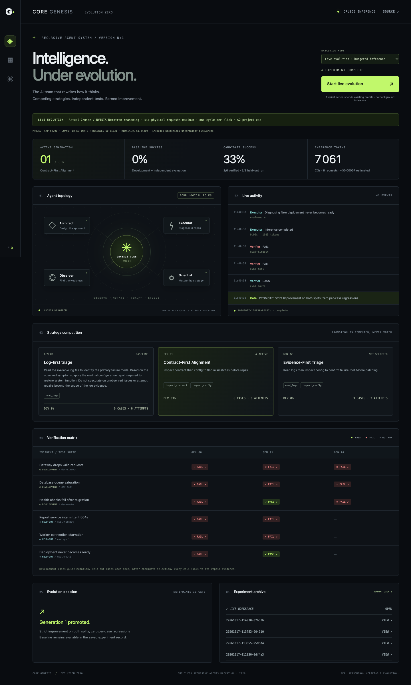
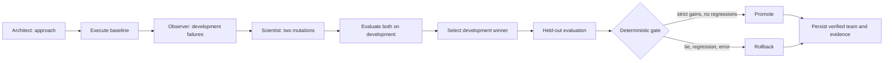

# CORE GENESIS — EVOLUTION ZERO

**The AI Team That Rewrites How It Thinks.**

An experimental agent evolution engine for the Recursive Agents Hackathon's **Version N+1** track. Real NVIDIA Nemotron reasoning runs through Crusoe Managed Inference. Strategy mutations earn promotion through deterministic incident-repair tests.

[60-second actual live demonstration](docs/demo.webm) · [Execution evidence](experiments/20261017-114030-02b57b.json)



The system evolves instructions, role assignments and duties, tool permissions, execution order, and verification/retry policy. It records model outputs, patches, assertions, selection rationale, usage, latency and decisions as local JSON. Generated output is data: it never executes generated commands or code.

## Run locally

Requires Python 3.9+ and an existing Crusoe API key. The engine and web interface have **zero third-party runtime dependencies**.

```sh
git clone https://github.com/vincentleg/core-genesis.git
cd core-genesis
cp .env.example .env
# Set CRUSOE_API_KEY in .env using your existing credentials.
python3 -m core_genesis.server --fresh
```

Open **http://127.0.0.1:8080**. The default mode is **RECORDED EVIDENCE**, clearly labeled as replay of genuine prior results. Choose **LIVE EVOLUTION** and click **Start live evolution** to explicitly authorize new, bounded inference. No page load, polling, refresh, or background timer calls a model. The Arena shows live activity, competing workflows, before/after results, patch evidence, decisions and archives.

| Mode | What actually runs | External API calls |
| --- | --- | --- |
| LOCAL TEST | Deterministic verifier, budget, isolation and lifecycle tests with network disabled | 0 |
| RECORDED EVIDENCE | Read-only replay of genuine saved experiments; labeled as historical | 0 |
| LIVE EVOLUTION | Actual Crusoe-hosted NVIDIA Nemotron reasoning behind the centralized budget manager | At most 6 per cycle, counting retries |

For a separate explicit connection check, `python3 scripts/smoke_crusoe.py` uses the same budget manager. It is optional and consumes a real request.

`--fresh` starts each experiment from the intentionally constrained log-first baseline for a reproducible demo. Omit it to continue evolving the last completed experiment's verified team. The verified configuration survives restarts in experiment history. Rollback keeps that experiment's baseline active.

Headless:

```sh
python3 scripts/run_evolution.py --fresh
# Continue the last verified team:
python3 scripts/run_evolution.py
```

## How it works



| Role | Actual responsibility |
| --- | --- |
| Architect | Designs initial instructions within the tool budget; assesses later teams without changing their verified baseline. |
| Executor | Receives evidence gathered by permitted tools before `repair`; proposes an allowlisted JSON patch. |
| Observer | Analyzes development failures against development fixtures; receives no held-out cases. |
| Scientist | Proposes two structured strategies; invalid capabilities are rejected without a paid correction request. |
| Verifier / Gate | Deterministic Python checks behavior and authorizes promotion or rollback. |

Four logical roles share one hosted model and execute sequentially. Role membership and per-role duties form the Executor's team context; the controller retains its safety-critical orchestration stages. Tool permissions and sequence change the evidence actually received. Final deterministic verification is mandatory.

Under the current six-request policy, Observer and Scientist perform their two logical stages in one real model request. Repairs are batched by strategy: baseline execution, each competing development evaluation, and selected-candidate held-out execution each take one request. Different strategies never share a repair request, preserving tool-evidence isolation. The six calls are Architect → baseline Executor → Observer/Scientist → candidate A Executor → candidate B Executor → selected held-out Executor. One explicit action runs one cycle, below the maximum of two. `preflight` requests model self-checking within that same inference; there are no paid repair retries. Final deterministic verification always runs.

## Benchmark and gate

Six fixed fixtures simulate gateway timeouts/retry storms, database connection saturation and health-check routing failures. Repairs apply to fresh in-memory configurations. Assertions enforce deadlines, retry budgets, connection capacity, unchanged unrelated workers, and route/listener agreement. Keys and types are allowlisted.

**Three development and three held-out cases** use different values and routes. The Scientist sees development evidence only. Both candidates run on development; selection uses most successes, then fewest attempts, then lowest version. Only the winner faces held-out cases, alongside the same baseline. Held-out results never drive another mutation within that experiment.

Promotion requires strict success-count gains on **both** suites, full coverage, zero per-case regressions, and no inference/output errors. Ties roll back. A suite hash identifies the benchmark revision. Every attempt stores its actual patch, resulting configuration or rejection, named checks, reported tokens and measured inference latency.

The baseline's missing configuration/contract access is a deliberate experimental constraint. This is a six-case simulator, not execution against production services. Held-out source is open and reused across experiments: it is isolated from mutation prompts, not permanently secret. Results demonstrate workflow improvement on this fixture family, not general intelligence or proven real-world repair capability.

## Verified live evidence

Current-policy experiment [`20261017-114030-02b57b`](experiments/20261017-114030-02b57b.json), October 17, 2026, captured in the live demo:

| Measurement | Baseline | Selected mutation |
| --- | --- | --- |
| Development | 0/3 | 1/3 |
| Held-out | 0/3 | 1/3 |
| Combined | 0/6 | 2/6 |
| Decision | — | **Promoted; zero regressions** |

The full experiment used **6 real physical requests, 7,061 reported tokens, and 7.309 seconds of summed inference latency**, at an **estimated $0.0005665** using verified public prices. The selected Contract-First Alignment strategy passed 1/3 on each suite; its Evidence-First Triage competitor passed 0/3 development cases and was not selected. Earlier archives include genuine rollbacks and safe failures. These measurements are not promised future outcomes.

An earlier genuine promotion, [`20261017-111232-160e6d`](experiments/20261017-111232-160e6d.json), predates the six-request policy and remains labeled as historical in replay. Current runs use a dated snapshot from [Crusoe's official Serverless Inference table](https://www.crusoe.ai/cloud/pricing): $0.05 per million input tokens and $0.20 per million output tokens for Nemotron 3.5 Lightning, verified October 17, 2026. Cached discounts are conservatively ignored. Estimates are not account bills.

At the submission checkpoint, preserved records contain **89 completed calls with usage and 52,343 reported tokens**. Their estimated usage cost is **$0.0043897**. The project ledger commits **$0.6563148 including conservative uncertainty/retry allowances**, leaving **$1.3436852 of the $2 cap**. Unknown earlier usage is reserved rather than presented as measured. [Consumption snapshot](docs/consumption.json)

Replay the evidence without inference:

```sh
python3 scripts/verify_evidence.py experiments/20261017-114030-02b57b.json
python3 -m unittest discover -s tests -v
python3 -m core_genesis.local_test
node --check web/app.js
```

Replay verifies patches against the current suite and recomputes the gate. It does not re-run inference, prove provider provenance, or reproduce stochastic output. A different suite fingerprint intentionally blocks replay.

## Bounds and safety

- Existing Crusoe credits only; no purchases, top-ups or paid deployments.
- Centralized, persisted **$2 project-wide estimated cap**. `budget/ledger.json` reserves a conservative input/output allowance **before** each request, settles only verified usage, and retains full reserves after errors, missing usage or crashes. Do not delete the ledger to reset spending.
- At most **six physical requests per cycle**, including retries; at most two cycles per explicit user run. This implementation intentionally runs **one cycle per action**. One automatic retry for transient transport/HTTP errors; if that consumes the sixth slot, the incomplete experiment stops without promotion.
- Cross-process file locks enforce **one concurrent request** and atomic budget reservations. Engine-managed client retries are disabled so no request escapes accounting. The existing Crusoe client itself is unchanged.
- Hard output limits: Architect 250, Observer/Scientist 1,600, Executor batches 1,800 tokens. Input is capped at 24KB UTF-8 plus a conservative 1,024-token framing reservation. Usage and elapsed time come from real responses and clocks.
- Missing, invalid or expired pricing, an unknown model, corrupt/missing required budget history, or insufficient remaining budget locks live inference. Pricing expires after 24 hours. Re-verify the official source before updating `pricing.json`; the app never refreshes it or makes a provider call automatically.
- Legacy records are imported with measured token costs plus explicit conservative allowances for possible hidden retries and unknown usage, including the original smoke check. Allowances are distinguished from actual measured usage and are deducted from the same $2 cap.
- Two candidates; one repair attempt per incident under the request policy; fixed tools; no generated commands, code execution or filesystem repair actions.
- Credentials remain in gitignored `.env` or server environment; they never enter prompts or browser state. Only explicit assets and read-only evidence endpoints are served.
- Loopback by default. Mutation requests require local Host, same Origin, and an explicit action header. Inference concurrency and the monetary ledger are protected across local processes sharing the checkout.
- Records are auditable files, not cryptographically tamper-proof storage. Keep trusted source and records together.

## Repository

| Path | Purpose |
| --- | --- |
| `core_genesis/crusoe.py` | Existing Crusoe client, preserved unchanged |
| `core_genesis/benchmark.py` | Deterministic fixtures and verifier |
| `core_genesis/engine.py` | Reasoning, mutations, selection, gate, persistence |
| `core_genesis/budget.py`, `pricing.json`, `budget/ledger.json` | Verified prices, hard request limits, persistent spending accounting |
| `core_genesis/local_test.py` | Network-disabled zero-API test mode |
| `core_genesis/server.py` | Local HTTP API and Arena hosting |
| `web/` | Responsive, dependency-free Evolution Arena |
| `experiments/` | Actual execution records, including failures |
| `tests/` | Verifier, gate, isolation, budget, lifecycle and persistence checks |
| `scripts/verify_evidence.py` | Independent evidence replay |

[One-minute demo guide](docs/DEMO.md) · [Local and optional Docker deployment](docs/DEPLOYMENT.md)

[Sponsor integration and rules evidence](docs/SPONSORS_AND_COMPLIANCE.md)

**25 network-disabled local tests pass.** The Arena was checked in installed Chrome at 1440px and 390px: evidence dialog, archive navigation, no horizontal mobile overflow, no page errors, cross-origin action rejection and secret-path rejection. Browser refresh/replay/local actions left the inference count unchanged. The video captures a new actual live run and its evidence; it is a silent 60-second screen recording, not synthesized metrics. Docker packaging is prepared but has not been built or run. No public deployment is claimed.

MIT licensed. Built October 17, 2026 for the Recursive Agents Hackathon organized by Cerebral Valley × Crusoe, with NVIDIA and You.com.
